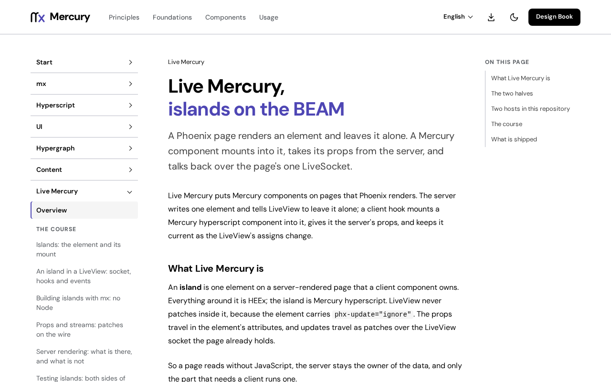

# @fiberfx/analytics

Mercury Analytics' browser client: the dashboard's islands on Mercury UI and Hyperscript, with a state scope per mount, mounted by Live Mercury's `MercuryHook`.

[](https://www.npmjs.com/package/@fiberfx/analytics) [](https://www.npmjs.com/package/@fiberfx/analytics)



*The [Live Mercury overview](https://mercury.jonnify.com/live-mercury) on mercury.jonnify.com: the analytics dashboard's islands mount the way this page describes.*

## Overview

Mercury Analytics is a Phoenix analytics dashboard whose LiveView components render islands; this package is their browser half. It renders each island with Mercury UI components (`Card`, `Stat`, `Chart`) on Mercury Hyperscript, gives every mount its own forked state scope, and mounts them through [Live Mercury](../live-mercury/)'s `MercuryHook`. It uses no React and no Tailwind.

## Install

```sh
npm install @fiberfx/analytics @fiberfx/core @fiberfx/hyperscript @fiberfx/live-mercury @fiberfx/ui
```

`@fiberfx/core`, `@fiberfx/hyperscript`, `@fiberfx/live-mercury` and `@fiberfx/ui` are peer dependencies.

## Usage

```ts
import { Socket } from "@fiberfx/phoenix";
import { LiveSocket } from "@fiberfx/phoenix_live_view";
import { analyticsHooks } from "@fiberfx/analytics";

new LiveSocket("/live", Socket, { hooks: { ...analyticsHooks() } });
```

`analyticsHooks()` returns `MercuryHook`, built with Live Mercury's `getHooks` over the package's `components` map.

| Island | State |
| --- | --- |
| `SingleStat` | `Stat` in a raised `Card`, with the figure and range from the island's props |
| `VisitsChart` | Visits and unique visitors per period on `Chart`; a bad count renders as an alert, never as a wrong curve |
| `RequestsChart`, `StatusChart`, `DeviceChart`, `PopularChart`, `ResChart`, `DateRangePicker`, `ColorSelector`, `ThemeToggle` | Named placeholders: they render a `Card`, not the chart yet |

## Entry points

| Import | Provides |
| --- | --- |
| `@fiberfx/analytics` | `analyticsHooks`, `components`, `scoped`, `SingleStat`, `VisitsChart`; the chart geometry (`curve`, `formatCount`, `niceMax`, `periodLabel`, `GeometryError`); and the model (`propsReceived`, `receive`, `mountScope`, `$rows`, `$figure`, `$range`, `$updates`) |

## Documentation

- [Live Mercury overview](https://mercury.jonnify.com/live-mercury)
- [Islands: the element and its mount](https://mercury.jonnify.com/live-mercury/islands) and [props and streams](https://mercury.jonnify.com/live-mercury/props-and-streams)
- [Mercury UI: feedback and data display](https://mercury.jonnify.com/ui/feedback-and-data)

For coding agents, every documentation page is also served as Markdown at `<page>/llms.txt`; start from the [agent index](https://mercury.jonnify.com/llms.txt).

## Related packages

- [`@fiberfx/live-mercury`](../live-mercury/): `MercuryHook`, which mounts these islands
- [`@fiberfx/ui`](../ui/): the `Card`, `Stat` and `Chart` components they render
- [`@fiberfx/phoenix_live_view`](../phoenix_live_view/): the LiveView client the hooks plug into

## License

Apache-2.0, as the package declares. The islands are ported from phoenix_analytics 0.4.2 by lalabuy948 (Apache-2.0); the npm package carries the LICENSE and NOTICE.txt files.
