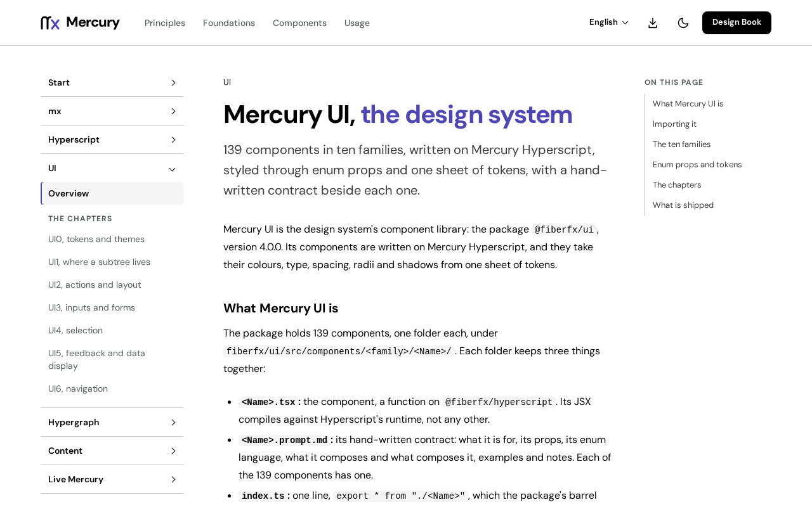

# @fiberfx/cms

Mercury CMS compositions: the collection workspace (search, filter chips, saved views, bulk actions and their outcome summary) over a host-declared collection model, and an asset picker. Presentational: state comes from the host's models.

[](https://www.npmjs.com/package/@fiberfx/cms) [](../LICENSE)



*The [Mercury UI overview](https://mercury.jonnify.com/ui) on mercury.jonnify.com: the CMS compositions are built from these components.*

## Overview

`@fiberfx/cms` holds the editorial screens an administrator works in, composed from [Mercury UI](../ui/) components on Mercury Hyperscript. A composition renders what it is given; it owns no storage server, permission or approval policy. The `CollectionWorkspace` reads its models through hooks whose shapes it declares itself (`WorkspaceCollectionView`, `WorkspaceBulkView`), so it imports no state library and works with any model that provides them. `AssetPicker` fills one asset slot, a usage, from a page of media assets; helpers such as `selectAsset`, `describeUsage` and `applyVariant` keep the usage record.

## Install

```sh
npm install @fiberfx/cms @fiberfx/hyperscript @fiberfx/ui
```

`@fiberfx/hyperscript` and `@fiberfx/ui` are peer dependencies.

## Usage

```tsx
import "@fiberfx/ui/styles.css";
import { CollectionWorkspace } from "@fiberfx/cms";

// collection: { useCollection(): WorkspaceCollectionView<Row> }
// bulk:       { useBulk(): WorkspaceBulkView }, optional
<CollectionWorkspace
  label="Documents"
  collection={collection}
  bulk={bulk}
  columns={[{ key: "title", label: "Title" }]}
  actions={[{ id: "publish", label: "Publish" }]}
/>
```

The host's model supplies the rows, the total, the filters and saved views through `useCollection()`, and the selection and bulk outcome through `useBulk()`.

## Entry points

| Import | Provides |
| --- | --- |
| `@fiberfx/cms` | `CollectionWorkspace` with `describeCount` and `summarizeOutcome`, and its types (`CollectionWorkspaceProps`, `WorkspaceCollectionView`, `WorkspaceBulkView`, `WorkspaceAction`, `WorkspaceFilter`, `WorkspaceSavedView`); `AssetPicker` with `selectAsset`, `describeUsage`, `applyVariant`, `descriptionMissing` and the media types (`MediaAsset`, `AssetUsage`, `AssetVariant`) |

## Documentation

- [Mercury UI overview](https://mercury.jonnify.com/ui)
- [Inputs and forms](https://mercury.jonnify.com/ui/inputs-and-forms), [selection](https://mercury.jonnify.com/ui/selection) and [feedback and data display](https://mercury.jonnify.com/ui/feedback-and-data)
- [Hypergraph](https://mercury.jonnify.com/hypergraph), for models that can back a workspace

For coding agents, every documentation page is also served as Markdown at `<page>/llms.txt`; start from the [agent index](https://mercury.jonnify.com/llms.txt).

## Related packages

- [`@fiberfx/ui`](../ui/): the components these compositions use
- [`@fiberfx/content`](../content/) and [`@fiberfx/schema`](../schema/): the published pages and the document format a CMS edits

## License

MIT. See [LICENSE](../LICENSE).
