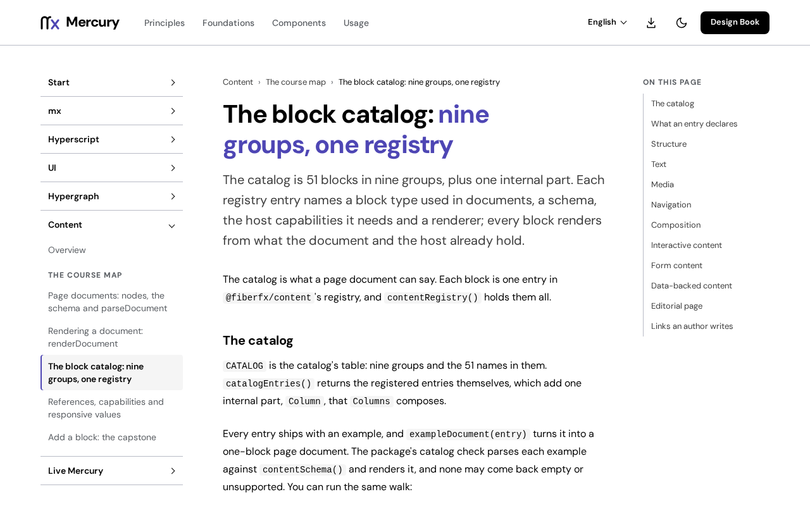

# @fiberfx/content

Mercury published pages: a renderer registry and block catalog that reads Mercury documents without the editor.

[](https://www.npmjs.com/package/@fiberfx/content) [](../LICENSE)



*[The block catalog: nine groups, one registry](https://mercury.jonnify.com/content/blocks) on mercury.jonnify.com.*

## Overview

`@fiberfx/content` turns a page document from [`@fiberfx/schema`](../schema/) into Mercury Hyperscript elements styled by [Mercury UI](../ui/). Its catalog registers each block type a document can use, with a schema, the host capabilities it needs, a renderer and an example. Its import graph has no builder, history or editing engine, so a published page loads only what it shows. The host resolves references (assets, routes, entities) and passes them in; rendering never fetches.

## Install

```sh
npm install @fiberfx/content @fiberfx/hyperscript @fiberfx/schema @fiberfx/ui
```

`@fiberfx/hyperscript`, `@fiberfx/schema` and `@fiberfx/ui` are peer dependencies.

## Usage

```ts
import { parseDocument } from "@fiberfx/schema";
import { contentSchema, renderDocument } from "@fiberfx/content";

const parsed = parseDocument(
  {
    format: 1,
    id: "hello",
    kind: "page",
    roots: ["page"],
    nodes: {
      page: { id: "page", type: "page", version: 1, props: { title: "Hello" }, slots: { content: ["intro"] } },
      intro: { id: "intro", type: "paragraph", version: 1, props: { text: "A first page." }, slots: {} },
    },
  },
  contentSchema(),
);

if (parsed.ok) {
  const { element, report } = renderDocument(parsed.document, { mode: "publication", revision: 1, lang: "en" });
  console.log(report); // { unsupported: [], publishable: true }
}
```

`renderDocument` does not validate: parse first, then render. It returns `{ element, report }`, where `element` is a Hyperscript `VNode` and `report` lists what could not be shown. Options include `theme` (`"light"` or `"dark"`), `dir`, `registry` (by default `contentRegistry()`, every catalog block), `resolved` (the host's answers for references, keyed `<kind>:<id>`), `capabilities` and `allowUnsupported`.

## Entry points

| Import | Provides |
| --- | --- |
| `@fiberfx/content` | `renderDocument`, `createRendererRegistry`, `schemaFor`, `BREAKPOINTS`; the block catalog (`CATALOG`, `catalogEntries`, `contentRegistry`, `contentSchema`, `exampleDocument`); and their types |

It ships as one ES module bundle with type declarations.

## Documentation

- [Content overview](https://mercury.jonnify.com/content)
- [Page documents](https://mercury.jonnify.com/content/documents) and [rendering a document](https://mercury.jonnify.com/content/rendering)
- [The block catalog](https://mercury.jonnify.com/content/blocks)
- [References, capabilities and responsive values](https://mercury.jonnify.com/content/references)
- [Add a block](https://mercury.jonnify.com/content/add-a-block)

For coding agents, every documentation page is also served as Markdown at `<page>/llms.txt`; start from the [agent index](https://mercury.jonnify.com/llms.txt).

## Related packages

- [`@fiberfx/schema`](../schema/): the document format and its parser
- [`@fiberfx/ui`](../ui/): the components and tokens blocks render with
- [`@fiberfx/hyperscript`](../hyperscript/): the runtime the rendered element belongs to

## License

MIT. See [LICENSE](../LICENSE).
