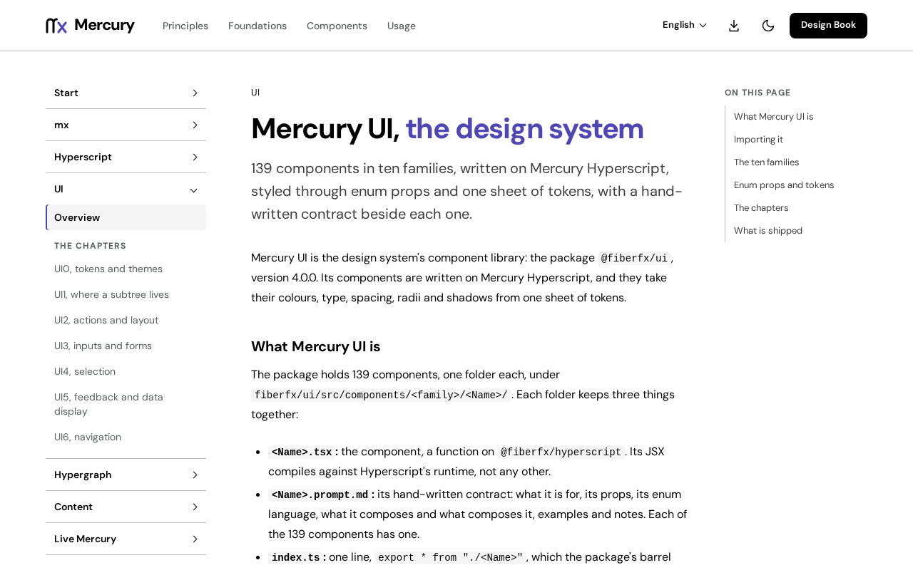

# @fiberfx/core

Mercury's UI-free foundation: a class utility, shared types, headless hooks and locale-aware date formatters. No components, no styles.

[](https://www.npmjs.com/package/@fiberfx/core) [](../LICENSE)



*The [Mercury UI overview](https://mercury.jonnify.com/ui) on mercury.jonnify.com; Mercury UI's components are built on this package.*

## Overview

`@fiberfx/core` is the layer under Mercury UI that carries no markup or CSS: the `cx` class utility, locale-aware date formatters and date values, headless behaviour hooks (focus trapping, dismissal, anchored positioning, presence, arrow-key navigation, calendars and date fields) and the shared type kit. [`@fiberfx/ui`](../ui/) declares it as a peer; you can also use it on its own for the utilities, without Mercury UI's styles. Its hooks run on Mercury Hyperscript.

## Install

```sh
npm install @fiberfx/core @fiberfx/hyperscript
```

`@fiberfx/hyperscript` is its only peer dependency. In a native Mercury app, keep the app's `mx.mod` and `mx.sum` and use `mx install` instead.

## Usage

```ts
import { cx, createFormatter } from "@fiberfx/core";

const className = cx("btn", isActive && "btn--active"); // conditional class names

const fmt = createFormatter({ locale: "en-US" });       // locale-aware Intl wrapper
fmt.fullMonthAndYear(new Date());
```

`createFormatter` takes a `locale` (a string, or a live source to follow a locale store) and optional `monthFormat` and `yearFormat`; every method formats through `Intl.DateTimeFormat` at the current locale.

## Entry points

| Import | Provides |
| --- | --- |
| `@fiberfx/core` | `cx`; the date formatters (`createFormatter`, `createTimeFormatter`) and date values (`CalendarDate`, `parseDate`); headless hooks such as `useFocusTrap`, `useDismiss`, `useAnchoredPosition`, `usePresence`, `useArrowNavigation`, `useCalendar`, `useDateField` and `useId`; and their types |

It ships as a single ES module bundle with type declarations. `@fiberfx/hyperscript` stays external as a peer.

## Documentation

- [Mercury UI overview](https://mercury.jonnify.com/ui) and [foundations](https://mercury.jonnify.com/ui/foundations)
- [Hooks, state and effects](https://mercury.jonnify.com/hyperscript/hooks)
- [API reference](https://mercury.jonnify.com/reference)

For coding agents, every documentation page is also served as Markdown at `<page>/llms.txt`; start from the [agent index](https://mercury.jonnify.com/llms.txt).

## Related packages

- [`@fiberfx/ui`](../ui/): the component library built on this package
- [`@fiberfx/hyperscript`](../hyperscript/): the runtime its hooks use

## License

MIT. See [LICENSE](../LICENSE).
