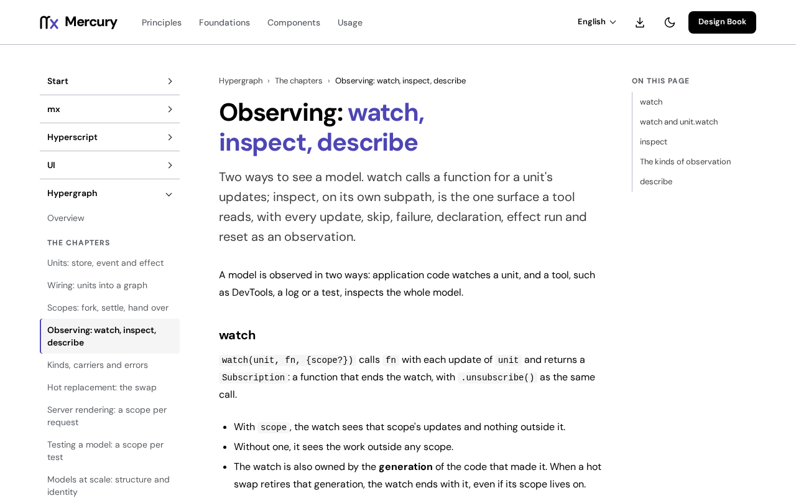

# @fiberfx/devtools

The Mercury Inspector: development-only inspection of a Mercury app's Hypergraph models, with a collector, a headless recorder for screen tests, a review export and an in-page dock.

[](https://www.npmjs.com/package/@fiberfx/devtools) [](../LICENSE)



*[Observing: watch, inspect, describe](https://mercury.jonnify.com/hypergraph/observing) on mercury.jonnify.com: the surface the Inspector reads.*

## Overview

The Inspector reads only [Hypergraph](../hypergraph/)'s public observation surface (`@fiberfx/hypergraph/inspect`, `watch` and a scoped read of a store) and never writes the app's graph, calls an event or writes a store. One collector feeds three surfaces: a dock in the page, a headless recorder for screen tests, and a review export that travels beside a review note. Records are bounded and detached, so a long session cannot grow without limit.

## Install

```sh
npm install @fiberfx/devtools
```

`@fiberfx/core`, `@fiberfx/hypergraph`, `@fiberfx/hyperscript` and `@fiberfx/ui` are peer dependencies.

## Usage

With the native toolchain, attach the Inspector to the dev server:

```sh
mx dev --inspect          # or "inspect": true in the app's mx.json
```

`mx dev` loads the Inspector before the app's entry, so it observes declarations before any model evaluates, and mounts the dock (Ctrl/Cmd+Shift+I). The app must resolve `@fiberfx/devtools` like its other modules.

The collector on its own:

```ts
import { connect } from "@fiberfx/devtools/connect";

const session = connect({ appId: "taskdesk" });          // one session per app id
session.observeDeclarations();                           // before the model loads
const release = session.registerScope({ id: "desk", label: "taskdesk", scope, stores: { draft: $draft } });
session.records();                                       // detached records, oldest first
session.detach();                                        // every subscription released
```

In a screen test:

```ts
import { recordSession } from "@fiberfx/devtools/test";

const s = recordSession({ scope, label: "taskdesk", stores: { decisions: $decisions } });
// render and interact
s.updates("draft");            // observed updates of a unit
s.causeChain("draft");         // from the root call to the unit's last update
s.detach();
```

## Entry points

| Import | Provides |
| --- | --- |
| `@fiberfx/devtools/connect` | `connect` (also `connectMercuryDevtools`), the collector session, protocol constants and the review constants |
| `@fiberfx/devtools/test` | `recordSession`, a headless recorder for screen tests |
| `@fiberfx/devtools/review` | `exportReview`, `REVIEW_SCHEMA`, `REVIEW_RECORDS`, `REVIEW_SUMMARY_CHARS`: the review protocol without the live collector, safe for a production reader |
| `@fiberfx/devtools/panel` | `mountInspectorDock(session)` and `mountDevtoolsPanel(element, session)`: the dock and panel on Mercury UI |
| `@fiberfx/devtools/panel.css` | The dock's stylesheet |

The dock shows a timeline, transactions by cause, units by module, stores and the session; it follows the page's `dark-theme` or `light-theme` class.

## Documentation

- [Observing: watch, inspect, describe](https://mercury.jonnify.com/hypergraph/observing)
- [Testing a model](https://mercury.jonnify.com/hypergraph/testing) and [hot replacement](https://mercury.jonnify.com/hypergraph/hot-replacement)
- [The dev loop with mx](https://mercury.jonnify.com/mx/dev)
- [Hypergraph overview](https://mercury.jonnify.com/hypergraph)

For coding agents, every documentation page is also served as Markdown at `<page>/llms.txt`; start from the [agent index](https://mercury.jonnify.com/llms.txt).

## Related packages

- [`@fiberfx/hypergraph`](../hypergraph/): the models the Inspector observes
- [`@fiberfx/testing`](../testing/): component tests that pair with `recordSession`
- [`@fiberfx/ui`](../ui/): the components the dock is built from

## License

MIT. See [LICENSE](../LICENSE).
