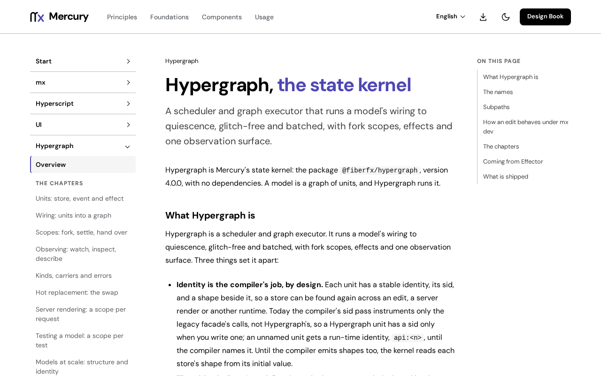

# @fiberfx/hypergraph

Mercury's state kernel: a scheduler and graph executor that runs a model's wiring to quiescence, glitch-free and batched, with fork scopes, effects and one observation surface.

[](https://www.npmjs.com/package/@fiberfx/hypergraph) [](../LICENSE)



*The [Hypergraph overview](https://mercury.jonnify.com/hypergraph) on mercury.jonnify.com.*

## Overview

Hypergraph is where a Mercury app keeps its state. A model is a graph of units (`store`, `event`, `effect`) joined by wiring (`sample`, `combine`, `split` and the rest); Hypergraph runs it to quiescence. A `fork` scope isolates a request, a test or a page and can be settled, snapshotted, restored and disposed. `inspect` is the one observation surface that tools such as the Mercury Inspector read. The package has no dependencies and runs on bare Node as well as in the browser; its `./hyperscript` entry binds models to Mercury Hyperscript components.

## Install

```sh
npm install @fiberfx/hypergraph
```

`@fiberfx/hyperscript` is an optional peer dependency, needed only for the `@fiberfx/hypergraph/hyperscript` binding.

## Usage

```ts
import { store, event, effect, sample, fork, allSettled, snapshot } from "@fiberfx/hypergraph";

const $count = store(0, { sid: "count" });
const add = event<number>();
$count.on(add, (n, by) => n + by);
const saveFx = effect(async (n: number) => fetch(`/count/${n}`));
sample({ clock: add, source: $count, target: saveFx });

const scope = fork();
await allSettled(add, { scope, params: 2 });
snapshot(scope); // {format: "mhg-scope/1", gen: 1, values: {count: {shape: "runtime:number", value: 2}}}
```

In a component, read a unit through the Hyperscript binding, under a `Provider` that holds the scope:

```tsx
import { render } from "@fiberfx/hyperscript";
import { Provider, useUnit } from "@fiberfx/hypergraph/hyperscript";

function Count() {
  const count = useUnit($count);
  return <output>{count}</output>;
}

render(<Provider value={scope}><Count /></Provider>, document.getElementById("app"));
```

On Node, `setCarrier(nodeCarrier())` (with `nodeCarrier` from `@fiberfx/hypergraph/node`) carries the scope down the async chain, so an unrelated call never joins a suspended flow.

## Entry points

| Import | Provides |
| --- | --- |
| `@fiberfx/hypergraph` | Units (`store`, `event`, `effect`), wiring (`sample`, `combine`, `split`, `attach`, `merge`, `restore`, `on`, `reset`, `map`, `filter`, `filterMap`, `prepend`, `watch`), scopes (`fork`, `allSettled`, `scopeBind`, `snapshot`, `diff`, `apply`, `dispose`), `kindOf`, `setCarrier`, `HypergraphError` |
| `@fiberfx/hypergraph/node` | `nodeCarrier`: an AsyncLocalStorage carrier for the scope on Node |
| `@fiberfx/hypergraph/inspect` | `inspect` and `describe`: the one observation surface |
| `@fiberfx/hypergraph/hyperscript` | `Provider`, `useUnit`, `useProvidedScope`, `setScopeMode`: the binding to Mercury Hyperscript components |

## Documentation

- [Hypergraph overview](https://mercury.jonnify.com/hypergraph)
- [Units](https://mercury.jonnify.com/hypergraph/units), [wiring](https://mercury.jonnify.com/hypergraph/wiring), [scopes](https://mercury.jonnify.com/hypergraph/scopes) and [models at scale](https://mercury.jonnify.com/hypergraph/models)
- [Observing: watch, inspect, describe](https://mercury.jonnify.com/hypergraph/observing) and [errors](https://mercury.jonnify.com/hypergraph/errors)
- [Testing a model](https://mercury.jonnify.com/hypergraph/testing), [hot replacement](https://mercury.jonnify.com/hypergraph/hot-replacement) and [server rendering](https://mercury.jonnify.com/hypergraph/server-rendering)
- [Coming from Effector](https://mercury.jonnify.com/hypergraph/coming-from-effector)
- [API reference](https://mercury.jonnify.com/reference)

For coding agents, every documentation page is also served as Markdown at `<page>/llms.txt`; start from the [agent index](https://mercury.jonnify.com/llms.txt).

## Related packages

- [`@fiberfx/reflect`](../reflect/): binds Hypergraph models to Hyperscript views
- [`@fiberfx/devtools`](../devtools/): the Mercury Inspector, built on `./inspect`
- [`@fiberfx/hyperscript`](../hyperscript/): the DOM runtime the `./hyperscript` binding targets

## License

MIT. See [LICENSE](../LICENSE).
