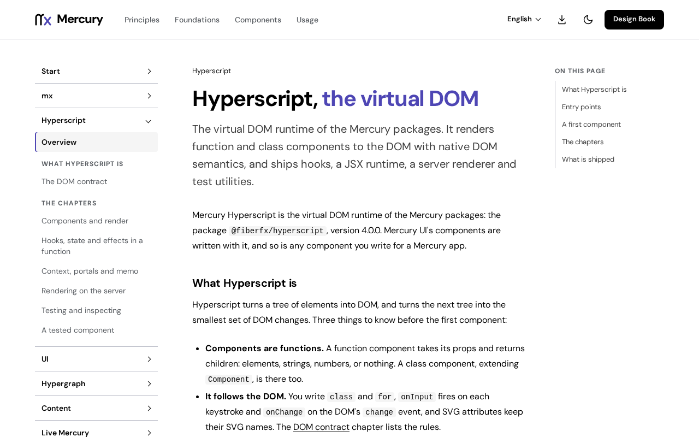

# @fiberfx/hyperscript

Mercury Hyperscript (MHS): the virtual DOM runtime of the Mercury packages, with hooks, a JSX runtime and a server renderer.

[](https://www.npmjs.com/package/@fiberfx/hyperscript) [](LICENSE)



*The [Hyperscript overview](https://mercury.jonnify.com/hyperscript) on mercury.jonnify.com.*

## Overview

Mercury Hyperscript renders function and class components to the DOM with native DOM semantics. It ships hooks, a client root API, a server renderer, an automatic JSX runtime and test utilities, and it has no React compatibility layer. Every other Mercury module builds on it: Mercury UI's components are written with it, Hypergraph models bind to it, Content renders page documents into it, and Live Mercury mounts its components as islands in Phoenix pages. The native `mx` toolchain compiles and serves apps written with it.

## Install

```sh
npm install @fiberfx/hyperscript
```

The package has no runtime or peer dependencies. In a native Mercury app, keep the app's module files and use `mx install` instead; the npm command is for an npm-managed project.

## Usage

```jsx
import { render } from '@fiberfx/hyperscript';
import { useState } from '@fiberfx/hyperscript/hooks';

function Counter() {
	const [count, setCount] = useState(0);
	return (
		<button class="counter" onClick={() => setCount(count + 1)}>
			{count}
		</button>
	);
}

render(<Counter />, document.getElementById('app'));
```

In a native Mercury app, `mx` selects the Hyperscript JSX runtime, so do not add a JSX pragma comment. Without JSX, `h(type, props, ...children)` builds the same tree; a browser-only page uses plain `h` calls and an import map, as the [browser route](https://mercury.jonnify.com/start/browser) shows.

### The DOM contract

Hyperscript follows the DOM, not React:

1. `class` and `for` are the authoring names, on HTML and SVG.
2. On a text input, `onInput` fires on every keystroke and `onChange` on the DOM's `change` event.
3. SVG attributes keep their SVG names: `stroke-width`, `fill-rule`, `clip-path`.
4. Focus that bubbles uses `onFocusIn` and `onFocusOut`.
5. Custom elements receive an object prop as a property and a string as an attribute; `onmy-event` listens to `my-event`.

Two behaviours differ from Preact 11 on purpose: a numeric style length is written in `px` (`style={{ width: 10 }}` is `width: 10px`) on the client and the server alike, and a controlled `<input>`, `<textarea>` or `<select>` keeps showing its `value` or `checked` prop when a handler refuses an edit.

## Entry points

| Import | Provides |
| --- | --- |
| `@fiberfx/hyperscript` | `render`, `hydrate`, `h`/`createElement`, `Fragment`, `createRef`, `cloneElement`, `isValidElement`, `Component`, `createContext`, `createPortal`, `toChildArray`, `memo` |
| `@fiberfx/hyperscript/hooks` | `useState`, `useReducer`, `useEffect`, `useLayoutEffect`, `useRef`, `useImperativeHandle`, `useMemo`, `useCallback`, `useContext`, `useDebugValue`, `useErrorBoundary`, `useId`, `useSyncExternalStore` |
| `@fiberfx/hyperscript/client` | `createRoot`, `hydrateRoot` |
| `@fiberfx/hyperscript/server` | `renderToString`, `renderToStringAsync`, `renderToStaticMarkup` |
| `@fiberfx/hyperscript/jsx-runtime`, `/jsx-dev-runtime` | The automatic JSX runtime (`jsx`, `jsxs`, `jsxDEV`, `Fragment`) |
| `@fiberfx/hyperscript/test-utils` | `act`, `setupRerender`, `teardown`, `onCommit`, `onDiff` |
| `@fiberfx/hyperscript/inspect` | `inspect`, `inspectFailures`: the renderer observed as detached records, root by root |
| `@fiberfx/hyperscript/debug` | Development warnings |
| `@fiberfx/hyperscript/hmr` | The development-only root registry that model replacement uses while serving; never part of a build |
| `@fiberfx/hyperscript/package.json` | The package manifest |

Every sub-path imports the runtime by its own name, so an application holds one runtime. There is no `./compat` entry.

## Documentation

- [Hyperscript overview](https://mercury.jonnify.com/hyperscript)
- [Components and render](https://mercury.jonnify.com/hyperscript/components), [hooks](https://mercury.jonnify.com/hyperscript/hooks), [context, portals and memo](https://mercury.jonnify.com/hyperscript/context)
- [The DOM contract](https://mercury.jonnify.com/hyperscript/dom)
- [Rendering on the server](https://mercury.jonnify.com/hyperscript/server)
- [Testing and inspecting](https://mercury.jonnify.com/hyperscript/testing) and [a tested component](https://mercury.jonnify.com/hyperscript/tested-component)
- [Start](https://mercury.jonnify.com/start), the [browser route](https://mercury.jonnify.com/start/browser) and the [API reference](https://mercury.jonnify.com/reference)

For coding agents, every documentation page is also served as Markdown at `<page>/llms.txt`; start from the [agent index](https://mercury.jonnify.com/llms.txt).

## Related packages

- [`@fiberfx/ui`](../ui/): Mercury UI's components, written on Hyperscript
- [`@fiberfx/hypergraph`](../hypergraph/): state models, with a Hyperscript binding
- [`@fiberfx/render-to-string`](../render-to-string/): the published name for `./server`
- [`@fiberfx/testing`](../testing/): component tests on Hyperscript
- [`@fiberfx/vite-plugin-mhs`](../vite-plugin-mhs/): JSX on Hyperscript in a Vite project

## License

MIT. Mercury Hyperscript is vendored from [Preact](https://github.com/preactjs/preact), and its server renderer from [preact-render-to-string](https://github.com/preactjs/preact-render-to-string), both MIT and both by Jason Miller. See [LICENSE](LICENSE).
