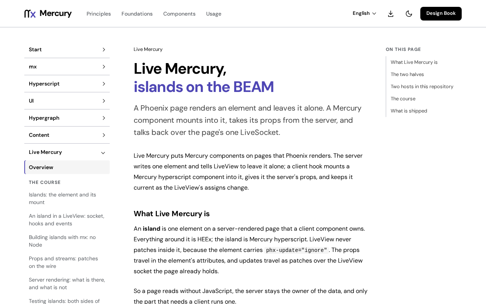

# @fiberfx/live-mercury

Live Mercury's browser client: `MercuryHook`, the native Hyperscript lifecycle that mounts Mercury islands in Phoenix LiveView pages, and the patch codecs their updates arrive in.

[](https://www.npmjs.com/package/@fiberfx/live-mercury) [](LICENSE)



*The [Live Mercury overview](https://mercury.jonnify.com/live-mercury) on mercury.jonnify.com.*

## Overview

Live Mercury puts Mercury components on pages that Phoenix renders. The server writes one element and tells LiveView to leave it alone; this client's hook mounts a Mercury Hyperscript component into it, gives it the server's props, and keeps it current as the LiveView's assigns change. So a page reads without JavaScript, the server stays the owner of the data, and only the part that needs a client runs one. It pairs with [`@fiberfx/phoenix`](../phoenix/) and [`@fiberfx/phoenix_live_view`](../phoenix_live_view/), the socket clients.

## Install

```sh
npm install @fiberfx/live-mercury @fiberfx/hyperscript
```

`@fiberfx/hyperscript` is a peer dependency: an island renders with the page's one runtime. A LiveView page also uses `@fiberfx/phoenix` and `@fiberfx/phoenix_live_view`.

## Usage

```ts
import { Socket } from "@fiberfx/phoenix";
import { LiveSocket } from "@fiberfx/phoenix_live_view";
import { getHooks } from "@fiberfx/live-mercury";
import { Counter } from "./islands/counter";

const liveSocket = new LiveSocket("/live", Socket, { hooks: getHooks({ Counter }) });
liveSocket.connect();
```

Each island element (`phx-hook="MercuryHook"`, `data-name="Counter"`) renders `components.Counter` with its props, its streams, the hook's six functions (`pushEvent`, `pushEventTo`, `handleEvent`, `removeHandleEvent`, `upload`, `uploadTo`) and its default slot. `useLiveMercury()` gives any component under an island those functions, and `Link` maps `href`, `patch`, `navigate` and `replace` to LiveView's `data-phx-link` attributes.

The codecs work on their own too:

```ts
import { applyPatch, decodeCompactPatch } from "@fiberfx/live-mercury";

const next = applyPatch(props, decodeCompactPatch(payload));
```

`applyPatch` is JSON Patch (RFC 6902) with Live Mercury's extensions (`upsert`, `limit` and `$$<id>` path segments that address an array item by `__dom_id`). It copies on write below the root; the root itself is mutated in place and returned.

## Entry points

| Import | Provides |
| --- | --- |
| `@fiberfx/live-mercury` | `getHooks`, `createMercuryHook` (the same lifecycle from a resolver, sync or async), `useLiveMercury`, `LiveMercuryProvider`, `LiveMercuryContext`, `Link`; the codecs `decodeCompactPatch`, `decodeCompactJson`, `applyPatch`, `applyOperation`, `getValueByPointer`; and their types |

## Documentation

- [Live Mercury overview](https://mercury.jonnify.com/live-mercury)
- [Islands: the element and its mount](https://mercury.jonnify.com/live-mercury/islands)
- [An island in a LiveView](https://mercury.jonnify.com/live-mercury/liveview)
- [Props and streams](https://mercury.jonnify.com/live-mercury/props-and-streams)
- [Server rendering](https://mercury.jonnify.com/live-mercury/server-rendering), [building islands with mx](https://mercury.jonnify.com/live-mercury/building) and [testing islands](https://mercury.jonnify.com/live-mercury/testing)

For coding agents, every documentation page is also served as Markdown at `<page>/llms.txt`; start from the [agent index](https://mercury.jonnify.com/llms.txt).

## Related packages

- [`@fiberfx/phoenix`](../phoenix/) and [`@fiberfx/phoenix_live_view`](../phoenix_live_view/): the Phoenix and LiveView clients
- [`@fiberfx/hyperscript`](../hyperscript/): the runtime islands render with
- [`@fiberfx/analytics`](../analytics/): a dashboard whose islands mount through `MercuryHook`

## License

MIT. Ported to TypeScript from [live_react](https://github.com/mrdotb/live_react) (MIT, Mrdotb): the codecs with their behaviour unchanged, the hook rewritten for Mercury Hyperscript. See [LICENSE](LICENSE).
