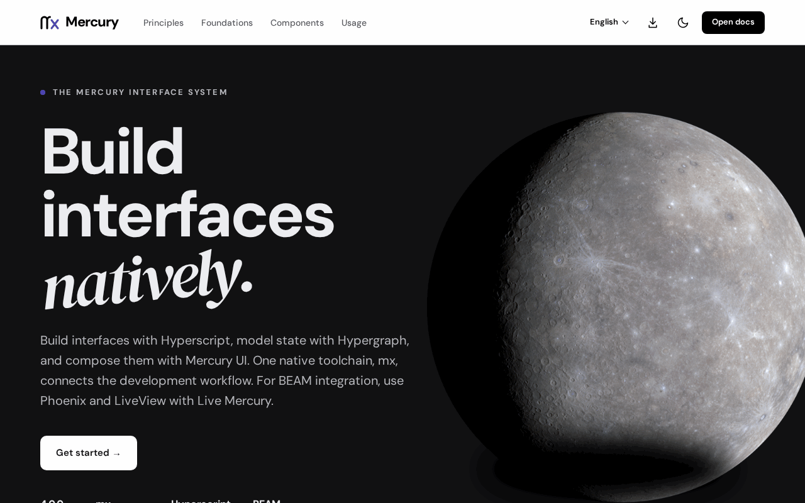

# Mercury

Mercury builds browser interfaces from Hyperscript components and Mercury UI, models their state with Hypergraph,
and develops, tests and bundles them with `mx`, its native toolchain. Phoenix and LiveView integration is optional.

*[mercury.jonnify.com](https://mercury.jonnify.com/), the documentation, courses and design book.*

## One toolchain, several packages

There is no single `@fiberfx/mercury` package to install. Mercury is a set of modules released together at one
version; install the ones your app uses, plus `mx` to build it. Each module's page below has its install line, a
minimal example and its entry points.

## Choose a route

- **A native app with `mx`.** Install the toolchain with `npm install --global @fiberfx/mx` (or from the release
  archives in [Install mx](https://mercury.jonnify.com/start/install-mx)), then follow the
  [first page](https://mercury.jonnify.com/mx/first-app) from an empty directory to a running, styled app.
- **A page without a CLI.** Plain JavaScript, an import map and the UI stylesheet, as the
  [browser guide](https://mercury.jonnify.com/start/browser) shows; this repository's
  [first page example](../site/examples/first-page.html) runs as is.
- **An existing Phoenix or LiveView app.** Add Mercury islands with [Live Mercury](https://mercury.jonnify.com/live-mercury).
- **An existing Mercury app.** Keep its tools and its pinned versions.

## The modules

| Module | What it is | npm | Docs |
| --- | --- | --- | --- |
| [mx](../mx/) | The native toolchain: build, dev server with hot reload, browser tests, module install |  | [mx](https://mercury.jonnify.com/mx) |
| [hyperscript](../hyperscript/) | The DOM runtime: virtual DOM, JSX runtime and hooks |  | [Hyperscript](https://mercury.jonnify.com/hyperscript) |
| [ui](../ui/) | Mercury UI: the token-driven component library |  | [UI](https://mercury.jonnify.com/ui) |
| [core](../core/) | The UI-free foundation: class utility, shared types, headless hooks, locale-aware dates |  | [Foundations](https://mercury.jonnify.com/ui/foundations) |
| [hypergraph](../hypergraph/) | The state kernel: units, wiring and scopes, glitch-free and batched |  | [Hypergraph](https://mercury.jonnify.com/hypergraph) |
| [reflect](../reflect/) | Binds Hypergraph models to Hyperscript views with typed props, keyed lists and variants |  | [Hypergraph](https://mercury.jonnify.com/hypergraph) |
| [schema](../schema/) | The portable page document format: block schemas, validation, commands and migrations |  | [Documents](https://mercury.jonnify.com/content/documents) |
| [content](../content/) | Published pages: the renderer registry and block catalog |  | [Content](https://mercury.jonnify.com/content) |
| [cms](../cms/) | The collection workspace: search, filters, saved views and bulk actions |  | [Reference](https://mercury.jonnify.com/reference) |
| [render-to-string](../render-to-string/) | The server renderer for Hyperscript |  | [Server rendering](https://mercury.jonnify.com/hyperscript/server) |
| [testing](../testing/) | Tests on Hyperscript: container-scoped queries, native events, `act`, `renderHook` |  | [Testing](https://mercury.jonnify.com/hyperscript/testing) |
| [devtools](../devtools/) | The Mercury Inspector: a development-only view of Hypergraph's scoped work |  | [Observing](https://mercury.jonnify.com/hypergraph/observing) |
| [vite-plugin-mhs](../vite-plugin-mhs/) | The Vite plugin for Hyperscript JSX, for apps built with Vite |  | [Reference](https://mercury.jonnify.com/reference) |
| [live-mercury](../live-mercury/) | Live Mercury's browser client: LiveView patch codecs and the hook that mounts islands |  | [Live Mercury](https://mercury.jonnify.com/live-mercury) |
| [phoenix](../phoenix/) | The Phoenix channels client for Mercury islands |  | [LiveView](https://mercury.jonnify.com/live-mercury/liveview) |
| [phoenix_live_view](../phoenix_live_view/) | The Phoenix LiveView client for Mercury islands |  | [LiveView](https://mercury.jonnify.com/live-mercury/liveview) |
| [analytics](../analytics/) | Mercury Analytics' browser client: dashboard islands mounted by Live Mercury |  | [Reference](https://mercury.jonnify.com/reference) |

## Learn and design

- [Start here](https://mercury.jonnify.com/start), [module stability](https://mercury.jonnify.com/start/stability)
  and the [API reference](https://mercury.jonnify.com/reference)
- [Design Book](https://mercury.jonnify.com/book): the design system's principles, with an interactive Design Lab;
  its editable source is in [book/](../book/)
- [Mercury Craft](https://mercury.jonnify.com/craft): practise action hierarchy, spacing and reading measure

## For agents

Every documentation page answers `<page>/llms.txt`; start at [llms.txt](https://mercury.jonnify.com/llms.txt). A
read-only MCP server serves skills and component prompts ([connection guide](https://mercury.jonnify.com/start/mcp)),
and [agents/](../agents/) in this repository holds the agent guide. Mercury uses Hyperscript, not React.

## License

Each module's README names its license; a module directory with its own LICENSE file carries that module's text. This
repository's [LICENSE](../LICENSE) covers the rest of its contents.
