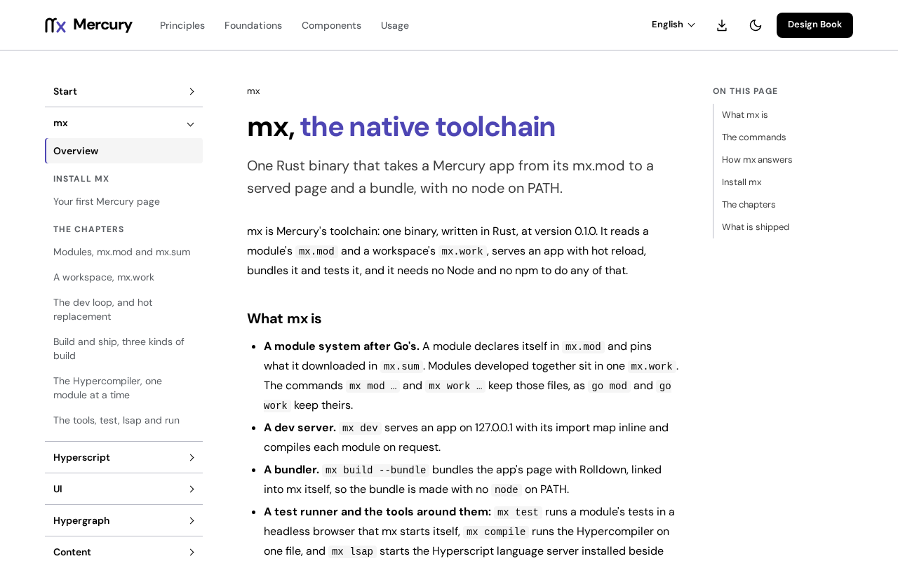

# @fiberfx/mx

The Mercury toolchain, `mx`, from npm: a small Node launcher and the native binary for your platform.

[](https://www.npmjs.com/package/@fiberfx/mx)
[](https://github.com/fiberfx/mercury/blob/master/LICENSE)



*The [mx course](https://mercury.jonnify.com/mx) on mercury.jonnify.com.*

## Overview

mx is Mercury's native toolchain, written in Rust. It installs and verifies modules, builds apps, hosts and library
packages, serves them with hot reload, and runs their tests in a real browser.

This package brings mx to any machine with Node. Its launcher, `cli.cjs`, runs under Node; npm installs exactly one
optional platform package, the one matching the host's operating system, CPU and C library, and the launcher starts
that binary with your arguments, output and exit code unchanged. Nothing is downloaded at install time and the package
has no install script.

## Install

```sh
npm install --global @fiberfx/mx
mx --version
```

Or for one project:

```sh
npm install --save-dev @fiberfx/mx
npx mx --version
```

Keep optional dependencies enabled. The binary is an optional dependency, so an install with `--omit=optional` leaves
the launcher without it.

## Platforms

| Platform | Package | Requires |
| --- | --- | --- |
| Linux x64 (glibc) | `@fiberfx/mx-linux-x64` | glibc 2.39 or later |
| Linux arm64 (glibc) | `@fiberfx/mx-linux-arm64` | glibc 2.39 or later |
| macOS arm64 | `@fiberfx/mx-darwin-arm64` | macOS 11 or later |
| macOS x64 | `@fiberfx/mx-darwin-x64` | macOS 11 or later |
| Windows x64 | `@fiberfx/mx-win32-x64` | |

The launcher needs Node 18 or later. The Linux and macOS packages also carry `hyperscript-lsap`, the Hyperscript
language server; the Windows package carries `mx.exe` alone. Linux with musl (Alpine) has no package yet.

## Commands

| Command | What it does |
| --- | --- |
| `mx build` | Builds what the directory holds: `mx.json` makes a host build, `index.html` beside `mx.mod` an app bundle, and `package.json` exports naming source entries a library package. `--host`, `--bundle`, `--lib` and `--package` choose explicitly. |
| `mx dev` | Serves the module or app with hot reload (`--root`, `--port`). |
| `mx test` | Runs the module's tests in a browser, each file a page. `MX_BROWSER` names the browser, else the first Chromium found. |
| `mx run <script>` | Runs a `package.json` script, or with `-r` the script of every package in the workspace, with a cache. |
| `mx install` | Fills the module store from `mx.mod`, each tree held to `mx.sum`. |
| `mx check` | Verifies a host build without writing anything. |
| `mx work` | Manages a workspace of several modules (`mx.work`). |

`mx <command> --help` prints each command's usage. The [first page](https://mercury.jonnify.com/mx/first-app)
walks from an empty directory to a running, styled app.

## Troubleshooting

The launcher explains what is missing rather than downloading anything:

- `missing optional package @fiberfx/mx-…`: npm skipped the platform package. Reinstall `@fiberfx/mx` with optional
  dependencies enabled, on a supported platform.
- `unsupported platform …; this release provides …`: no package matches this host; the message lists those that exist.
- `glibc … is too old or unknown`: the Linux binaries need glibc 2.39 or later.

Without Node, use the release archives and their SHA-256 sums described in
[Install mx](https://mercury.jonnify.com/start/install-mx).

## Documentation

- [mx course](https://mercury.jonnify.com/mx) and its chapters: [first page](https://mercury.jonnify.com/mx/first-app),
  [build](https://mercury.jonnify.com/mx/build), [dev](https://mercury.jonnify.com/mx/dev),
  [modules](https://mercury.jonnify.com/mx/modules), [workspace](https://mercury.jonnify.com/mx/workspace),
  [tools](https://mercury.jonnify.com/mx/tools)
- [Install mx](https://mercury.jonnify.com/start/install-mx) and [module stability](https://mercury.jonnify.com/start/stability)
- [API reference](https://mercury.jonnify.com/reference); for agents, every page also answers `<page>/llms.txt`

## Related

- [Mercury overview](https://github.com/fiberfx/mercury/tree/master/mercury#readme): every module and how they fit
- [@fiberfx/hyperscript](https://github.com/fiberfx/mercury/tree/master/hyperscript#readme),
  [@fiberfx/ui](https://github.com/fiberfx/mercury/tree/master/ui#readme),
  [@fiberfx/hypergraph](https://github.com/fiberfx/mercury/tree/master/hypergraph#readme)

## License

MIT. Each platform package also includes `THIRD_PARTY_NOTICES.txt` for the Rust crates linked into its binaries and
the Rust standard library's license, `RUST-STANDARD-LIBRARY.html`.
