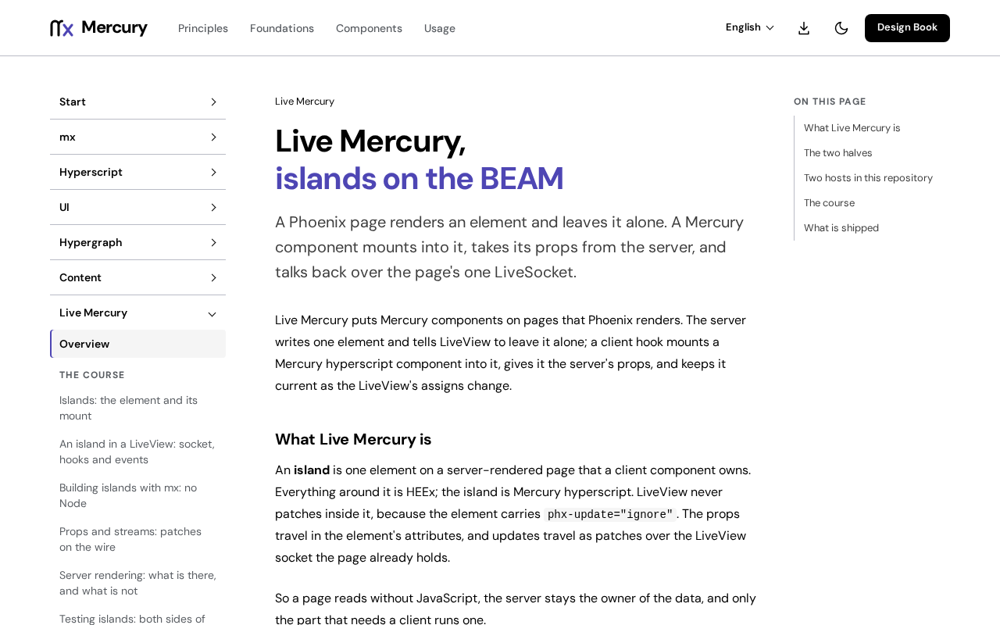

# @fiberfx/phoenix

The Phoenix JavaScript client (`Socket`, `Channel`, `Presence`, `LongPoll`, `Serializer`), ported to TypeScript for Mercury islands.

[](https://www.npmjs.com/package/@fiberfx/phoenix) [](LICENSE)



*The [Live Mercury overview](https://mercury.jonnify.com/live-mercury) on mercury.jonnify.com: islands on Phoenix pages use this client.*

## Overview

This is the [Phoenix](https://www.phoenixframework.org/) channels client: one socket connection to the server, with channels multiplexed over it. Mercury uses it under [`@fiberfx/phoenix_live_view`](../phoenix_live_view/) and [Live Mercury](../live-mercury/), which mount Mercury Hyperscript components as islands in Phoenix pages. It ships standard ES2024 modules with TypeScript declarations and needs no bundler: Node imports it directly, and a browser loads it through an import map that maps `@fiberfx/phoenix` to the file.

## Install

```sh
npm install @fiberfx/phoenix
```

It has no peer dependencies.

## Usage

```ts
import { Socket } from "@fiberfx/phoenix";

const socket = new Socket("/socket", { params: { token } });
socket.connect();
const channel = socket.channel("room:lobby", {});
channel.join();
```

## Entry points

| Import | Provides |
| --- | --- |
| `@fiberfx/phoenix` | `Socket`, `Channel`, `Presence`, `LongPoll`, `Serializer` |

## Documentation

- [Live Mercury overview](https://mercury.jonnify.com/live-mercury)
- [An island in a LiveView: socket, hooks and events](https://mercury.jonnify.com/live-mercury/liveview)
- [Islands: the element and its mount](https://mercury.jonnify.com/live-mercury/islands)
- The upstream [Phoenix documentation](https://hexdocs.pm/phoenix/channels.html) on channels

For coding agents, every documentation page is also served as Markdown at `<page>/llms.txt`; start from the [agent index](https://mercury.jonnify.com/llms.txt).

## Related packages

- [`@fiberfx/phoenix_live_view`](../phoenix_live_view/): the LiveView client on this socket
- [`@fiberfx/live-mercury`](../live-mercury/): `MercuryHook`, which mounts Mercury islands

## License

MIT. Derived from the Phoenix JavaScript client, Copyright (c) 2014 Chris McCord. See [LICENSE](LICENSE).
