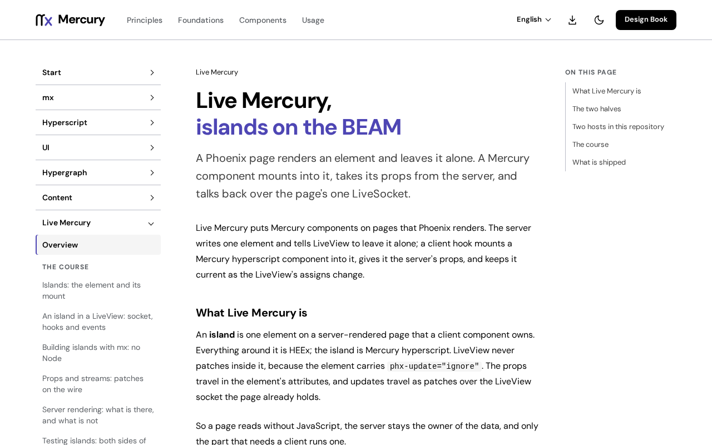

# @fiberfx/phoenix_live_view

The Phoenix LiveView JavaScript client, ported to TypeScript for Mercury islands.

[](https://www.npmjs.com/package/@fiberfx/phoenix_live_view) [](LICENSE)



*The [Live Mercury overview](https://mercury.jonnify.com/live-mercury) on mercury.jonnify.com: islands live inside LiveView pages driven by this client.*

## Overview

`LiveSocket` connects a page to its Phoenix LiveView over a [`@fiberfx/phoenix`](../phoenix/) socket and applies the server's updates. Mercury islands from [`@fiberfx/live-mercury`](../live-mercury/) plug into it as hooks. The package ships standard ES2024 modules with TypeScript declarations and needs no bundler. It also carries a `phoenix_html` replacement, so `phoenix_html` is not a dependency of the client bundle.

## Install

```sh
npm install @fiberfx/phoenix @fiberfx/phoenix_live_view
```

`@fiberfx/phoenix` is a peer dependency.

## Usage

```ts
import { Socket } from "@fiberfx/phoenix";
import { LiveSocket } from "@fiberfx/phoenix_live_view";

const liveSocket = new LiveSocket("/live", Socket, { params: { _csrf_token: token } });
liveSocket.connect();
```

To mount Mercury islands, pass Live Mercury's hooks: `new LiveSocket("/live", Socket, { hooks: getHooks({ Counter }) })`, with `getHooks` from `@fiberfx/live-mercury`.

## Entry points

| Import | Provides |
| --- | --- |
| `@fiberfx/phoenix_live_view` | `LiveSocket`, `createHook`, `ViewHook`, `Hook`, `isUsedInput`, `getFileURLForUpload`, and the option and hook types |
| `@fiberfx/phoenix_live_view/phoenix_html` | The replacement for the `phoenix_html` single-file import in assets |

## Documentation

- [Live Mercury overview](https://mercury.jonnify.com/live-mercury)
- [An island in a LiveView: socket, hooks and events](https://mercury.jonnify.com/live-mercury/liveview)
- [Props and streams](https://mercury.jonnify.com/live-mercury/props-and-streams)
- The upstream [JavaScript interoperability guide](https://hexdocs.pm/phoenix_live_view/js-interop.html) for the LiveView client

For coding agents, every documentation page is also served as Markdown at `<page>/llms.txt`; start from the [agent index](https://mercury.jonnify.com/llms.txt).

## Related packages

- [`@fiberfx/phoenix`](../phoenix/): the socket this client runs on
- [`@fiberfx/live-mercury`](../live-mercury/): `MercuryHook`, which mounts Mercury islands

## License

MIT. Derived from Phoenix LiveView, Copyright (c) 2018 Chris McCord. See [LICENSE](LICENSE).
