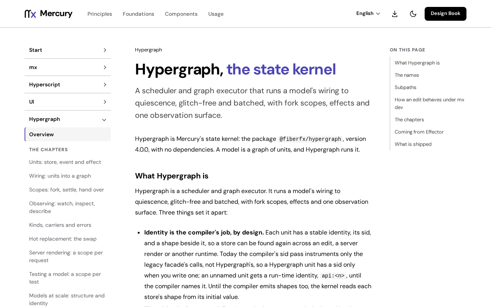

# @fiberfx/reflect

Mercury Reflect binds Hypergraph models to Hyperscript views with typed props, keyed lists, variants and scope-aware callbacks.

[](https://www.npmjs.com/package/@fiberfx/reflect) [](../LICENSE)



*The [Hypergraph overview](https://mercury.jonnify.com/hypergraph) on mercury.jonnify.com: Reflect connects these models to views.*

## Overview

Reflect sits between [Hypergraph](../hypergraph/), Mercury's state, and [Hyperscript](../hyperscript/), its DOM runtime. A view stays an ordinary component; Reflect supplies its reactive props from stores, scope-bound callbacks from events, and composition through `variant` and `list`. It works with any Hyperscript component, including Mercury UI's controls.

## Install

```sh
npm install @fiberfx/reflect @fiberfx/hypergraph @fiberfx/hyperscript
```

`@fiberfx/hypergraph` and `@fiberfx/hyperscript` are peer dependencies, at the same Mercury version. The example below also uses `@fiberfx/ui`.

## Usage

```tsx
import { event, store } from "@fiberfx/hypergraph";
import { reflect } from "@fiberfx/reflect";
import { Input } from "@fiberfx/ui";

const nameChanged = event<string>();
const $name = store("").on(nameChanged, (_, name) => name);

const Name = reflect({
  view: Input,
  bind: {
    value: $name,
    onInput: (event: Event) => nameChanged((event.currentTarget as HTMLInputElement).value),
  },
});
```

Use the control's actual callback shape: Mercury UI's `Input` passes a native event to `onInput`, while `Checkbox` passes a boolean to `onChange`. Reflect does not reinterpret arguments. A function in `bind` runs in the nearest `Provider` from `@fiberfx/hypergraph/hyperscript`; `setScopeMode("required")` refuses an accidental fallback outside a scope.

A keyed list of rows from an array store:

```tsx
import { list } from "@fiberfx/reflect";

const $items = store([{ id: "first", title: "Read the contract" }]);
const Item = (props: { label: string }) => <li>{props.label}</li>;

const Items = list({
  source: $items,
  view: Item,
  getKey: (item) => item.id,
  mapItem: { label: (item, index) => `${index + 1}. ${item.title}` },
});
```

| Operator | Result |
| --- | --- |
| `reflect({ view, bind, mapProps?, hooks? })` | A component with reactive stores, scoped callbacks and bound defaults |
| `createReflect(view)(bind, options?)` | The same binding with its view fixed |
| `variant({ source, cases, default?, ... })` | The component named by a string store; unknown cases use the fallback |
| `variant({ if, then, else?, ... })` | A boolean choice, with the same bindings, mappings and hooks |
| `list({ source, view, getKey?, mapItem?, bind?, mapProps?, hooks? })` | Keyed reflected rows from an array store |
| `fromTag(tag)` | A view of one native element, keeping the known tag's prop types |

`hooks.mounted` and `hooks.unmounted` may be a callback, an event or an effect; they are scoped and do not run during server rendering.

## Entry points

| Import | Provides |
| --- | --- |
| `@fiberfx/reflect` | `reflect`, `createReflect`, `variant`, `list`, `fromTag`, and the types `BindProps`, `MapProps`, `ReflectedProps`, `View` and the rest |

The npm package also includes `src/Reflect.prompt.md`, the binding's contract written for coding agents.

## Documentation

- [Hypergraph overview](https://mercury.jonnify.com/hypergraph)
- [Units](https://mercury.jonnify.com/hypergraph/units), [scopes](https://mercury.jonnify.com/hypergraph/scopes) and [testing a model](https://mercury.jonnify.com/hypergraph/testing)
- [Hyperscript components](https://mercury.jonnify.com/hyperscript/components)
- [Mercury UI inputs and forms](https://mercury.jonnify.com/ui/inputs-and-forms)

For coding agents, every documentation page is also served as Markdown at `<page>/llms.txt`; start from the [agent index](https://mercury.jonnify.com/llms.txt).

## Related packages

- [`@fiberfx/hypergraph`](../hypergraph/): the models Reflect reads
- [`@fiberfx/hyperscript`](../hyperscript/): the views Reflect renders
- [`@fiberfx/ui`](../ui/): Mercury UI's controls, ready to bind

## License

MIT. Reflect's operators began as a port of [@effector/reflect](https://github.com/effector/reflect) (MIT); [NOTICE.txt](NOTICE.txt) lists the files still modified from it. See [LICENSE](../LICENSE).
