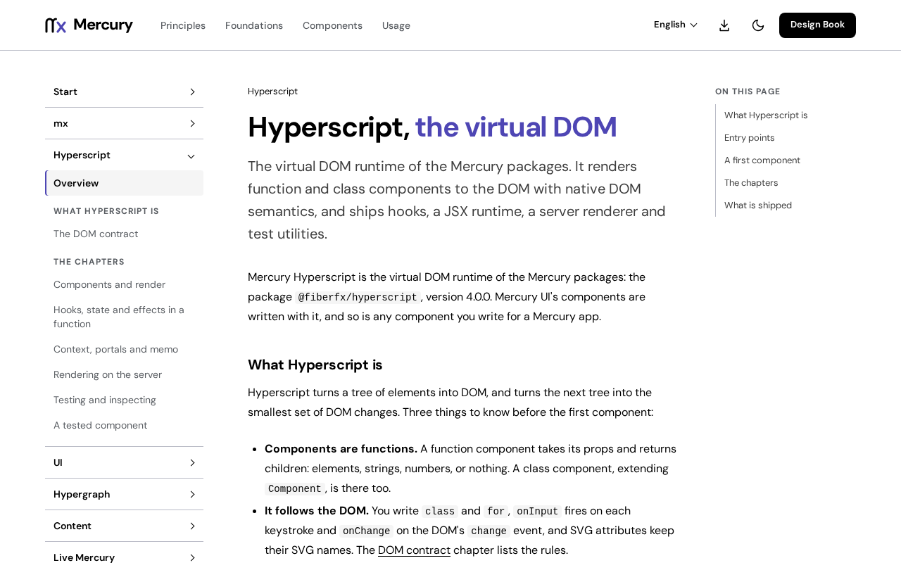

# @fiberfx/render-to-string

Mercury's server renderer: `renderToString` for `@fiberfx/hyperscript` components, published under its own name. ESM only.

[](https://www.npmjs.com/package/@fiberfx/render-to-string) [](../LICENSE)



*The [Hyperscript overview](https://mercury.jonnify.com/hyperscript) on mercury.jonnify.com; this package renders those components to HTML.*

## Overview

This package is the published name for `@fiberfx/hyperscript/server`, where Mercury's one server renderer lives. It re-exports that entry unchanged, so a component renders to the same HTML whichever name you import: `class`, `for` and SVG attribute names are kept, and numeric style lengths are written in `px` as on the client. Use it to produce a page's first HTML on the server, then `hydrate` it with Mercury Hyperscript in the browser.

## Install

```sh
npm install @fiberfx/render-to-string @fiberfx/hyperscript
```

`@fiberfx/hyperscript` is a peer dependency: the renderer renders the page's one runtime.

## Usage

```jsx
import { renderToString } from '@fiberfx/render-to-string';

const html = renderToString(<App />);
```

`renderToStringAsync` is the asynchronous variant: it returns a promise of the HTML.

## Entry points

| Import | Provides |
| --- | --- |
| `@fiberfx/render-to-string` | `renderToString` (also the default export), `renderToStringAsync`, `renderToStaticMarkup`, `render` |
| `@fiberfx/render-to-string/package.json` | The package manifest |

Not exported: `./jsx` (pretty output), `./stream` and `./stream-node`.

## Documentation

- [Rendering on the server](https://mercury.jonnify.com/hyperscript/server)
- [Hyperscript overview](https://mercury.jonnify.com/hyperscript)
- [Hypergraph: a scope per request](https://mercury.jonnify.com/hypergraph/server-rendering)
- [Live Mercury: what server rendering covers](https://mercury.jonnify.com/live-mercury/server-rendering)

For coding agents, every documentation page is also served as Markdown at `<page>/llms.txt`; start from the [agent index](https://mercury.jonnify.com/llms.txt).

## Related packages

- [`@fiberfx/hyperscript`](../hyperscript/): the runtime, whose `./server` entry this package re-exports

## License

MIT. The renderer is vendored from [preact-render-to-string](https://github.com/preactjs/preact-render-to-string) (MIT, Jason Miller and contributors). See [LICENSE](../LICENSE).
