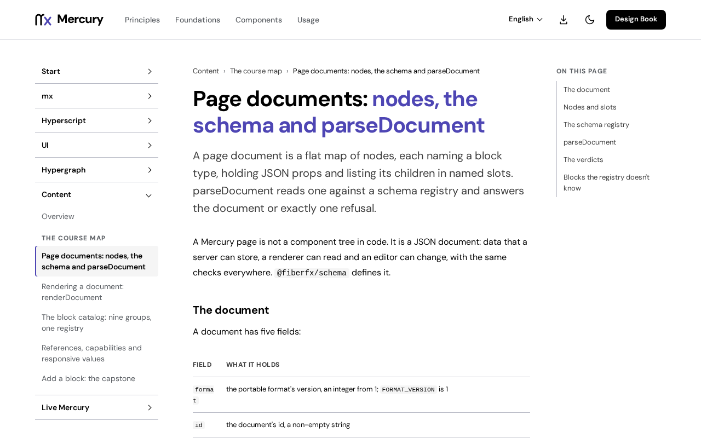

# @fiberfx/schema

Mercury documents: the portable, versioned, JSON-safe page format, with block schemas, validation at declared limits, atomic commands and migrations.

[](https://www.npmjs.com/package/@fiberfx/schema) [](../LICENSE)



*[Page documents: nodes, the schema and parseDocument](https://mercury.jonnify.com/content/documents) on mercury.jonnify.com.*

## Overview

A Mercury page is not a component tree in code: it is a JSON document that a server can store, a renderer can read and an editor can change, with the same checks everywhere. `@fiberfx/schema` defines that document, the registry of block schemas it is checked against, and one command layer that applies edits atomically or refuses them. It has no DOM handles and no UI dependency; [`@fiberfx/content`](../content/) renders the documents it parses.

## Install

```sh
npm install @fiberfx/schema
```

It has no peer dependencies.

## Usage

```ts
import { applyCommand, createSchemaRegistry, parseDocument } from "@fiberfx/schema";

const registry = createSchemaRegistry({
  blocks: [
    { type: "section", version: 1, props: {}, slots: { content: {} } },
    { type: "heading", version: 1, props: { text: { kind: "string" }, level: { kind: "number", integer: true, min: 1, max: 6 } } },
  ],
});

const parsed = parseDocument(jsonText, registry); // { ok: true, document } or { ok: false, code, path, reason }
if (parsed.ok) {
  const result = applyCommand(
    { document: parsed.document, revision: 0 },
    { kind: "set-properties", expectedRevision: 0, node: "title", props: { level: 2 } },
    { registry },
  ); // { ok: true, local: { document, revision: 1 }, impact } or a refusal; the input is unchanged
}
```

- **Document:** `format`, `id`, `kind` (`page`, `fragment`, `template`), ordered `roots` and a flat `nodes` map. A node has `id`, `type`, `version`, JSON `props` and named `slots` of child IDs.
- **Refusals** share one shape: a typed `code`, a JSON Pointer `path`, a `reason`, the `subject` it points into and, when there is one, the `node`. Parsing, commands and migration never return a partial document.
- **Commands:** insert, remove, move, duplicate and set-properties, each against an expected local revision.
- **Limits** (`maxDepth`, `maxBytes`, `maxNodes`, `maxPropDepth`) are declared per registry and hold for every result.
- **Migration:** `migrateDocument` steps older block versions forward on a copy; a lossy step needs `{ allowLossy: true }`.
- **Unknown blocks** are kept unchanged through parsing, edits, saves and migration; `inspectDocument` reports them `unsupported`.
- **References** (`{ "$ref": "asset" | "route" | "entity" | "fragment", "id" }`) resolve beside the document with `resolveReferences`; **responsive values** (`{ "$responsive": { "base", "overrides" } }`) are read with `resolveResponsive`.

Client validation helps authors; the host still authorizes every change on its server.

## Entry points

| Import | Provides |
| --- | --- |
| `@fiberfx/schema` | `parseDocument`, `createSchemaRegistry`, `createRuntimeRegistry`, `createNode`, `applyCommand`, `validateCommand`, `migrateDocument`, `inspectDocument`, `resolveReferences`, `resolveResponsive`, `collectReferences`, `indexConsumers`, `documentCodec`, `FORMAT_VERSION`, `DEFAULT_LIMITS`, and their types |

## Documentation

- [Page documents: nodes, the schema and parseDocument](https://mercury.jonnify.com/content/documents)
- [References, capabilities and responsive values](https://mercury.jonnify.com/content/references)
- [Rendering a document](https://mercury.jonnify.com/content/rendering) and [the block catalog](https://mercury.jonnify.com/content/blocks)
- [Content overview](https://mercury.jonnify.com/content)

For coding agents, every documentation page is also served as Markdown at `<page>/llms.txt`; start from the [agent index](https://mercury.jonnify.com/llms.txt).

## Related packages

- [`@fiberfx/content`](../content/): renders parsed documents with a block catalog

## License

MIT. See [LICENSE](../LICENSE).
