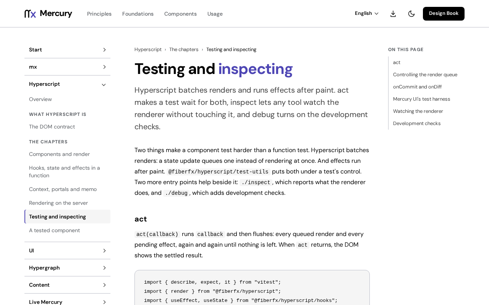

# @fiberfx/testing

Tests on Mercury Hyperscript: `render` with container-scoped queries, exact native events, an `act` that drains the renderer, `renderHook` and a render-loop guard, on DOM Testing Library's queries.

[](https://www.npmjs.com/package/@fiberfx/testing) [](../LICENSE)



*[Testing and inspecting](https://mercury.jonnify.com/hyperscript/testing) on mercury.jonnify.com.*

## Overview

`@fiberfx/testing` tests components on the runtime your users ship. It uses one renderer, Mercury Hyperscript's own `render` and `act`, with a port of DOM Testing Library's queries, and no React, React Testing Library or Preact adapter. Events are the native ones: `change` is the DOM's commit event and `focus` does not bubble. Beside the component helpers it carries an in-memory WebSocket for tests (`./socket`), jest-dom style matchers (`./matchers`) and read-only focus evidence (`inspectFocus`).

## Install

```sh
npm install --save-dev @fiberfx/testing @fiberfx/hyperscript
```

`@fiberfx/hyperscript` is a peer dependency, at the same Mercury version. Your test runner provides the DOM environment.

## Usage

```ts
import { cleanup, render, typeInto, waitFor } from "@fiberfx/testing";

afterEach(cleanup);

const view = render(<Search />);                       // queries are bound to this container
typeInto(view.getByRole("searchbox"), "alpha");        // input, then change
await waitFor(() => expect(view.getByText("Alpha")).toBeTruthy());
```

| Export | What it does |
| --- | --- |
| `render(ui, { container?, baseElement? })` | Mounts inside `act` and returns queries bound to the container, plus `rerender`, `unmount` and `debug`. `screen` is document-wide and explicit. |
| `cleanup()` | Unmounts every tree `render` mounted and removes only the containers it created. |
| `act(callback)` | Runs the callback, awaits the promise it returns, and drains queued renders and effects, with no extra microtask turns. |
| `fireEvent` | DOM Testing Library's, each call inside `act`, dispatching exactly the native event named. |
| `typeInto(element, value)` | Sets the value, then fires `input` and then `change`, as typing and commit do. |
| `renderHook(hook, { initialProps?, wrapper? })` | Gives `result.current`, `rerender(props?)` and `unmount`. |
| `guardRenders({ budget, label })` | Throws `RenderBudgetExceeded` once a guarded stretch exceeds `budget` diffs, failing an update loop while it runs. |
| `screen`, `within`, `waitFor`, `waitForElementToBeRemoved`, `getBy*`, `queryBy*`, `findBy*` and their `All` forms | A port of DOM Testing Library, with no npm dependency. |

An in-memory WebSocket and server, with real frames and no network:

```js
import { WebSocket, Server, init } from "@fiberfx/testing/socket";

await init();

const server = new Server("wss://example.com/live");
server.on("connection", ({ connection }) => connection.send("hello"));

const socket = new WebSocket("wss://example.com/live");
socket.onmessage = (event) => console.log(event.data);
```

## Entry points

| Import | Provides |
| --- | --- |
| `@fiberfx/testing` | `render`, `cleanup`, `act`, `fireEvent`, `typeInto`, `renderHook`, `guardRenders`, `inspectFocus`, `FocusEvidenceError` and the DOM Testing Library queries |
| `@fiberfx/testing/matchers` | `matchers` for `expect.extend`: `toBeInTheDocument`, `toHaveAttribute`, `toHaveFocus`, `toHaveTextContent`, `toBeDisabled`, `toBeEnabled`, `toHaveClass`, `toHaveValue` |
| `@fiberfx/testing/socket` | `WebSocket`, `Server` and `init`: an RFC 6455 engine built to WebAssembly, for tests; call `await init()` once first |

## Documentation

- [Testing and inspecting](https://mercury.jonnify.com/hyperscript/testing) and [a tested component](https://mercury.jonnify.com/hyperscript/tested-component)
- [Testing a model: a scope per test](https://mercury.jonnify.com/hypergraph/testing)
- [Testing islands](https://mercury.jonnify.com/live-mercury/testing)
- [The DOM contract](https://mercury.jonnify.com/hyperscript/dom)

For coding agents, every documentation page is also served as Markdown at `<page>/llms.txt`; start from the [agent index](https://mercury.jonnify.com/llms.txt).

## Related packages

- [`@fiberfx/hyperscript`](../hyperscript/): the runtime under test
- [`@fiberfx/devtools`](../devtools/): `recordSession` for screen tests over Hypergraph models

## License

MIT. See [LICENSE](../LICENSE).
