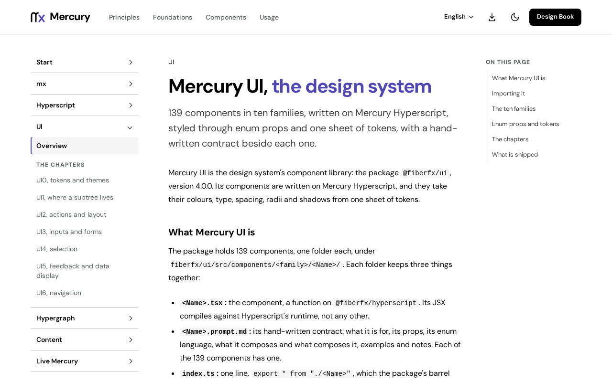

# @fiberfx/ui

Mercury UI: the Mercury design system's component library on `@fiberfx/hyperscript`, styled through enum props and one sheet of tokens.

[](https://www.npmjs.com/package/@fiberfx/ui) [](../LICENSE)



*The [Mercury UI overview](https://mercury.jonnify.com/ui) on mercury.jonnify.com.*

## Overview

Mercury UI is a library of presentational components written on Mercury Hyperscript. They take their colours, type, spacing, radii and shadows from one sheet of CSS tokens, and you style them through enum props (`variant`, `size`, `tone`) rather than class overrides. Ten component families cover foundations, actions, layout, inputs, forms, selection, navigation, overlays, feedback and data display. [`@fiberfx/core`](../core/) supplies the headless hooks and utilities underneath, and state comes from your app, for example a [Hypergraph](../hypergraph/) model bound with [Reflect](../reflect/).

## Install

```sh
npm install @fiberfx/ui @fiberfx/core @fiberfx/hyperscript
```

`@fiberfx/core` and `@fiberfx/hyperscript` are peer dependencies; no React peer is required. In a native Mercury app, keep its `mx.mod` and `mx.sum` and use `mx install` instead. The [Start guide](https://mercury.jonnify.com/start) covers the native and browser-only routes.

## Usage

```tsx
import "@fiberfx/ui/styles.css";       // required: components are class-driven
import { Button, Card } from "@fiberfx/ui";

export function App() {
  return (
    <Card>
      <Button variant="primary">Ship it</Button>
    </Card>
  );
}
```

Load the full stylesheet once at your app root; importing the JavaScript entry alone does not load the component styles. `@fiberfx/ui/tokens.css` is a separate tokens-only sheet and does not replace the full stylesheet. A browser-only HTML page loads the version-pinned stylesheet with a `<link rel="stylesheet">`, as the [browser route](https://mercury.jonnify.com/start/browser) shows. A `dark-theme` class on an ancestor selects the dark tokens.

## Entry points

| Import | Provides |
| --- | --- |
| `@fiberfx/ui` | The components (`Button`, `Card`, `Input`, `Checkbox`, `Select` and the rest) and their prop types |
| `@fiberfx/ui/styles.css` | The full stylesheet: tokens and component rules |
| `@fiberfx/ui/tokens.css` | The design tokens alone |

## Documentation

- [Mercury UI overview](https://mercury.jonnify.com/ui) and [foundations](https://mercury.jonnify.com/ui/foundations)
- [Tokens and themes](https://mercury.jonnify.com/ui/tokens-and-themes)
- [Actions and layout](https://mercury.jonnify.com/ui/actions-and-layout), [inputs and forms](https://mercury.jonnify.com/ui/inputs-and-forms), [selection](https://mercury.jonnify.com/ui/selection), [navigation](https://mercury.jonnify.com/ui/navigation), [feedback and data display](https://mercury.jonnify.com/ui/feedback-and-data)
- The [Design Book](https://mercury.jonnify.com/book) and [Craft](https://mercury.jonnify.com/craft)
- [Start](https://mercury.jonnify.com/start), the [browser route](https://mercury.jonnify.com/start/browser) and the [API reference](https://mercury.jonnify.com/reference)

For coding agents, every documentation page is also served as Markdown at `<page>/llms.txt`; start from the [agent index](https://mercury.jonnify.com/llms.txt).

## Related packages

- [`@fiberfx/core`](../core/): the UI-free foundation (hooks, `cx`, date formatters)
- [`@fiberfx/hyperscript`](../hyperscript/): the runtime the components are written on
- [`@fiberfx/reflect`](../reflect/): binds Hypergraph models to these components
- [`@fiberfx/cms`](../cms/) and [`@fiberfx/content`](../content/): compositions and published pages built from them

## License

MIT. See [LICENSE](../LICENSE).
