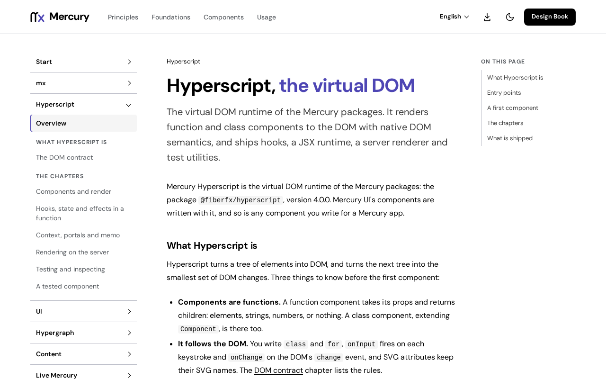

# @fiberfx/vite-plugin-mhs

The Vite plugin for Mercury Hyperscript (MHS): automatic JSX on `@fiberfx/hyperscript`, explicit source and installed resolution, and clear refusals for modes that are not available.

[](https://www.npmjs.com/package/@fiberfx/vite-plugin-mhs) [](LICENSE)



*The [Hyperscript overview](https://mercury.jonnify.com/hyperscript) on mercury.jonnify.com: this plugin compiles JSX for that runtime in a Vite project.*

## Overview

Mercury apps are usually built with the native [`mx`](https://mercury.jonnify.com/mx) toolchain. For a project that builds with Vite instead, this plugin lowers JSX to `@fiberfx/hyperscript`, resolves Mercury packages from their built artifacts (or, inside the Mercury workspace, from their sources), and refuses any configuration that would put a foreign renderer beside MHS: a React or Preact plugin, an alias for `react`, `react-dom` or `preact`, or a conflicting JSX setting. It is ESM only and has no dependencies of its own.

## Install

```sh
npm install --save-dev @fiberfx/vite-plugin-mhs vite
npm install @fiberfx/hyperscript
```

`vite` and `@fiberfx/hyperscript` are peer dependencies: `vite` at the exact version `package.json` pins, and `@fiberfx/hyperscript` at the same Mercury version.

## Usage

```ts
// vite.config.ts
import mhs from '@fiberfx/vite-plugin-mhs';
import { defineConfig } from 'vite';

export default defineConfig({ plugins: [mhs()] });
```

`.jsx` and `.tsx` files then compile against `@fiberfx/hyperscript/jsx-runtime` (`/jsx-dev-runtime` in dev) through Vite's own Oxc transform. Write `class`, `for` and native events, as the [DOM contract](https://mercury.jonnify.com/hyperscript/dom) describes. For your editor and `tsc`, set the same import source in `tsconfig.json`:

```json
{ "compilerOptions": { "jsx": "preserve", "jsxImportSource": "@fiberfx/hyperscript" } }
```

`mhs()` returns an array of plugins; put it in `plugins` as is.

| Option | Values | Default | Meaning |
| --- | --- | --- | --- |
| `resolution` | `'installed'`, `'source'` | `'installed'` | `'installed'` resolves `@fiberfx/*` from their built files. `'source'` adds the `mercury-source` export condition so the workspace's sources load with no build; use it only inside the Mercury workspace. |
| `compiler` | `'oxc'`, `'hypercompiler'` | `'oxc'` | Vite's Oxc transform, or the bundled Rust/WASM Hypercompiler, lowers TSX to native MHS. |
| `optimizer`, `refresh`, `ssr` | `false` | off | Unavailable; any other value is refused rather than ignored. |

The opt-in `sid`, `scope` and `modelHmr` options (stable unit ids, a required-scope mode and model replacement in development) work with `compiler: 'hypercompiler'`; their types document each one. Every refusal is an `MhsConfigError` with a `code`: `MHS_INVALID_OPTION`, `MHS_UNAVAILABLE` or `MHS_CONFLICT`.

## Entry points

| Import | Provides |
| --- | --- |
| `@fiberfx/vite-plugin-mhs` | `mhs` (also the default export), `MhsConfigError`, `RUNTIME`, `SOURCE_CONDITION`, and the types `MhsOptions`, `MhsSidOptions`, `MhsErrorCode` |
| `@fiberfx/vite-plugin-mhs/package.json` | The package manifest |

It keeps your aliases, conditions, externals, build settings and asset handling, and adds no alias. Source maps are Vite's, composed with the transforms before them. Edits reload the page under Vite's normal rules.

## Documentation

- [Hyperscript overview](https://mercury.jonnify.com/hyperscript) and [the DOM contract](https://mercury.jonnify.com/hyperscript/dom)
- [Start](https://mercury.jonnify.com/start) and [stability](https://mercury.jonnify.com/start/stability)
- [mx, the native toolchain](https://mercury.jonnify.com/mx), and [the Hypercompiler, one module at a time](https://mercury.jonnify.com/mx/compile)

For coding agents, every documentation page is also served as Markdown at `<page>/llms.txt`; start from the [agent index](https://mercury.jonnify.com/llms.txt).

## Related packages

- [`@fiberfx/hyperscript`](../hyperscript/): the runtime the plugin compiles JSX for
- [`@fiberfx/testing`](../testing/): component tests on the same runtime

## License

MIT. See [LICENSE](LICENSE).
